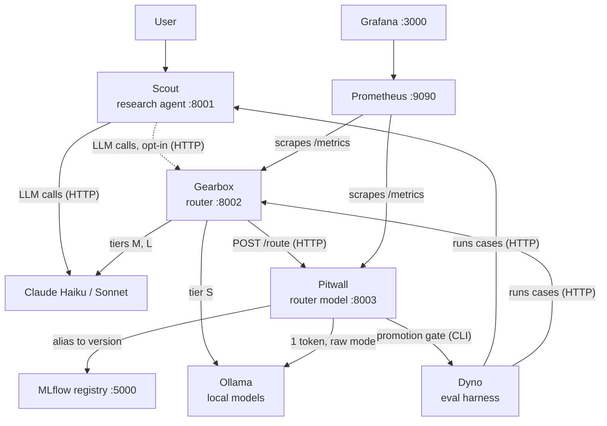
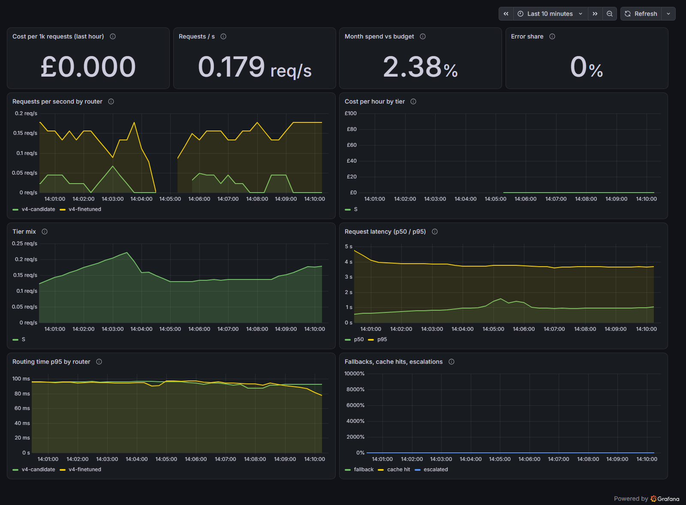

# uv-ai-stack

[](https://github.com/Utsav0706/uv-ai-stack/actions/workflows/ci.yml)

Four AI projects that each work on their own and run together as one system: a research
agent, a router that picks the cheapest model good enough for each request, an
evaluation harness that judges them, and the operations around the router's own model.

> - **Gearbox cuts LLM cost by 93% at 95% of quality** against always using the large
>   model, on 119 held-out prompts ([report](https://github.com/Utsav0706/gearbox/blob/main/reports/eval.md)).
> - **Scout answers research questions in 30 s (median) for £0.024 a report**, with every
>   kept claim checked against its source, and says "not enough evidence" on 8/8 trick
>   questions ([baseline](https://github.com/Utsav0706/scout/blob/main/eval/results/baseline-2026-10-28/summary.md)).
> - **Dyno's CI gate blocked a bad Scout change that every unit test passed**: task
>   success fell from 80% to 40% ([report](https://github.com/Utsav0706/dyno/blob/main/reports/m9-gate-demo.md)).
> - **Pitwall's fine-tuned 0.6B router replaces a paid classifier** at higher quality
>   for about £0 a decision, and ran the whole loop live: drift, retraining, Dyno gate,
>   canary, promotion, rollback ([results](https://github.com/Utsav0706/pitwall#results)).

| Project | What it does |
|---|---|
| [Scout](https://github.com/Utsav0706/scout) | Research agent: plans, searches the web and private documents, reads, verifies every claim, writes a cited report |
| [Gearbox](https://github.com/Utsav0706/gearbox) | LLM router with OpenAI- and Anthropic-compatible APIs: picks tier S (local), M (Haiku) or L (Sonnet) per request, logs cost and reason |
| [Dyno](https://github.com/Utsav0706/dyno) | Evaluation harness for agents: test cases, trajectory scorers, calibrated LLM judges, run comparison, a CI gate |
| [Pitwall](https://github.com/Utsav0706/pitwall) | LLMOps for Gearbox's router model: versioned data, fine-tuning, registry, gate, canary, monitoring, drift, retraining |

**Status:** all four projects complete; integration steps I1-I4, I6 and most of I5 done
(`stack loop`, the tooling for the Scout comparison). Still to come: I5b (Scout through
Gearbox on the full golden set, judged by Dyno) and the cloud deploy.

## How they connect



The projects connect only through HTTP APIs, command lines and files (JSONL, YAML, a
DVC import of Gearbox's labelled prompts), never by importing each other's code. That
keeps each one installable on its own, lets each pin its own dependencies (Gearbox needs
`anthropic<2`, Dyno `>=2.3`), and makes every connection something a test can call.

- **Scout to Gearbox:** Scout speaks the Anthropic Messages format and Gearbox serves
  `/v1/messages`, so routing Scout through Gearbox is one line of Scout config. Gearbox
  picks the tier from Scout's task tag and never goes above the model Scout asked for.
  Off by default until I5 has measured it on the full golden set.
- **Gearbox to Pitwall:** Gearbox's router v4 calls Pitwall's `POST /route`, with a 10%
  canary to the candidate model; if Pitwall is down, Gearbox falls back to tier M.
- **Dyno to Scout and Gearbox:** HTTP adapters run Dyno's cases against the running
  services; Dyno's judges score the answers, and its gate fails a pull request when
  results get worse.
- **Pitwall to Dyno:** a new router model is promoted only if Dyno's gate passes on 119
  cases through the running service.
- **Gearbox and Pitwall to Prometheus:** both export `/metrics`; Grafana shows Pitwall's
  router dashboard and Gearbox's cost dashboard.

## The loop

One loop goes through all four: requests are routed and logged, and the router model is
watched for drift, retrained, gated and rolled out again.

1. **Route.** A request reaches Gearbox (from Scout or any client); Gearbox asks
   Pitwall for the tier and records the cost, tier, router version and reason.
2. **Watch.** Prometheus and Grafana track cost per 1,000 requests, tier mix, errors and
   routing latency; Pitwall compares recent prompts with its training data.
3. **Notice.** Pitwall's drift check flagged a new kind of prompt (research share
   26% to 51%, embedding classifier AUC 0.90) and the `PitwallDrift` alert fired.
4. **Learn.** Thumbs-downs and a sample judged by Dyno became new Dyno cases and new
   training prompts; v2 was fine-tuned on Colab in 256 s.
5. **Gate.** Dyno's gate ran the 119 cases through the running service: no drop in
   accuracy, no more under-routing, p95 within 600 ms.
6. **Roll out.** 10% of Gearbox's traffic went to v2 as a canary, then v2 was promoted
   by moving the MLflow alias; a rollback to v1 and re-promotion worked the same way.

Every step was run live; the record is in
[Pitwall's README](https://github.com/Utsav0706/pitwall#the-loop-run-end-to-end).

`stack loop` runs the loop against the system `stack up` started, in one command:

```bash
stack loop
```

1. **Route:** 60 of Pitwall's test prompts through Gearbox, which asks Pitwall for the
   tier (10% go to the candidate as the canary). Capped at the local tier, so it's free.
2. **Watch:** Pitwall's drift check on the prompts its production model routed (cached
   answers and canary requests don't count; the check needs at least 30).
3. **Gate:** Dyno's promotion gate on the candidate as a dry run: nothing in the
   registry moves. When the candidate already is production there is nothing to
   release, and `--gate-ref v1` gates a named version instead.
4. **Report:** drift, the gate's verdict, the alerts Prometheus has firing.

`--source pool_new` sends the drifted prompts instead, and `--promote` makes step 3 the
real release: a canary replay through Gearbox (paid, capped by `--cap-gbp`), its report
in MLflow, then the gate, which moves the production alias on a pass. A live run on
19 November: 60 prompts (43 routed by production, 7 by the canary, 10 from Gearbox's
cache), no drift, and the gate on v1 against production v2 passed every rule (task
success 48% vs 48%, under-routing 8.4% vs 8.4%, p95 488 ms), so v1 *would promote*: the
two versions route the same prompts the same way. The aliases didn't move.

## What connecting them showed

| Step | Result |
|---|---|
| I2: Gearbox metrics in Prometheus | Both targets scraped; 8 alert rules; cost per 1,000 requests measured live at £0.073 on a mixed-tier sample |
| I3: Gearbox's live evaluation through Dyno | 30 test prompts: Dyno quality 90%, 91% saved against always-L, Dyno's judge agrees with Gearbox's own on 28 of 30 ([report](https://github.com/Utsav0706/gearbox/blob/main/reports/eval_dyno.md)) |
| I4: the whole system as one command | 6 services healthy in ~2.5 GB; a request through Gearbox routed by Pitwall; CI builds the pinned commits in Docker Compose and passes 10 smoke checks |
| I5: Scout through Gearbox, judged by Dyno | Pending (after Tavily's monthly reset, ~£2.80); the 1-case smoke test passed both ways, £0.0181 -> £0.0135 a question |

Gearbox's dashboard in Grafana while the system runs (`stack up`, free tier-S traffic
routed by Pitwall):



## Run the system

On Windows, from each project's own virtual environment (each checkout next to this one,
set up as its README says; Ollama running):

```bash
stack up
stack status
stack down
```

`stack up` starts MLflow, Pitwall, Gearbox, Scout, Prometheus and Grafana in dependency
order, waits for each health check, and reuses anything already running. Gearbox routes
through Pitwall (router `v4-finetuned`, 10% canary to `v4-candidate`) using a config
generated in `runs/`, so no project's repository is changed. `--ui` adds the three
Streamlit apps; `--scout-via-gearbox` sends Scout's model calls through Gearbox.
`stack status` shows health, process and memory; `stack down` stops only what `stack up`
started.

| Service | Port |
|---|---|
| Scout API | 8001 |
| Gearbox API (`/metrics` for Prometheus) | 8002 |
| Pitwall API | 8003 |
| MLflow | 5000 |
| Prometheus | 9090 |
| Grafana | 3000 |
| Scout UI, Gearbox dashboard, Dyno dashboard (`--ui`) | 8501, 8502, 8503 |

A free request to try (Pitwall picks the tier; the header caps it at the local model):

```bash
curl http://127.0.0.1:8002/v1/chat/completions -H "content-type: application/json" -H "x-gearbox-max-tier: S" -d "{\"model\":\"auto\",\"messages\":[{\"role\":\"user\",\"content\":\"Capital of France?\"}]}"
```

The response headers say what happened: `x-gearbox-router: v4-finetuned`, and
`x-gearbox-reason` with Pitwall's probabilities and request id.

On Linux or with Docker, [`docker-compose.yml`](docker-compose.yml) runs the same system
with each project's stores (Postgres, Redis):

```bash
stack config gearbox --pitwall-url http://pitwall:8003 --out runs/gearbox-compose.yaml
docker compose up -d --build
```

CI's `system` job checks out the four pinned commits, builds and starts that file, and
runs [`scripts/system_smoke.py`](scripts/system_smoke.py): every service healthy, a
request to Gearbox routed through Pitwall (both record it), Prometheus scraping both,
Grafana's dashboards loaded. CI has no model keys, so the request ends in a clean 503.

## Pinned versions

[`stack.toml`](stack.toml) pins each project to the commit that was tested together.
`stack pins` compares the pins with the local checkouts (`../scout`, `../gearbox`, ...);
`stack pins --update` moves them on purpose; CI checks every pinned commit exists on
GitHub and builds the system from them.

```bash
py -m venv .venv
.venv\Scripts\activate
pip install -e ".[dev]"
stack pins
```

## What it cost

Paid API calls, as each project's own README or reports record them:

| | Paid spend |
|---|---|
| Gearbox (dataset answers, judging, probes, live eval) | about £4.85 |
| Dyno (baselines, before/after, gate demo, judges) | under £4 |
| Scout | £1.63 for the 50-question baseline, £0.055 for the red-team run |
| Pitwall (training on free Colab; canaries, sampled judging) | about £0.022 |
| Integration so far (I1-I5a) | about £0.06 |

Every paid command shows an estimate first and stops at a cap. Running costs are in each
project's README.

## Limits and what's next

- **I5b** measures Scout through Gearbox on the full 50-question golden set, judged by
  Dyno, before that becomes the default (~£2.80; the tooling is built and smoke-tested).
- **The cloud deploy** of all four together is planned separately; today everything runs
  on one machine or in Compose.
- **The router model doesn't beat "always use M".** Gearbox, Pitwall and Dyno all found
  that which tier a prompt needs is barely predictable from its text; the savings come
  from not using the large model by default. The loop around the model works
  regardless.
- **Test sets are small** (119 router prompts, 50 research questions), so differences of
  a few points are within noise; each report gives its sample size.

More: [visitor FAQ](docs/faq.md).

## Integration steps

| Step | What | Paid cost |
|---|---|---|
| I1 | This repository, pinned versions, CI | £0 |
| I2 | Gearbox metrics (incl. cost) in Pitwall's Prometheus and Grafana | £0.003 |
| I3 | Gearbox's live evaluation through Dyno | £0.018 |
| I4 | One command to start the whole system; Compose file checked in CI | £0 |
| I5a | Dyno's eval workflow can route Scout through Gearbox; the comparison report; a 1-case smoke test | £0.036 |
| I5b | Scout through Gearbox, judged by Dyno on the full golden set | ~£2.80 |
| I5c | `stack loop`: the loop through all four as one command | £0 |
| I6 | This README and the visitor FAQ | £0 |
